# 月明かり · Tsukiakari

月色里的聊天应用。支持 Windows 桌面、安卓手机和平板，提供好友私聊、邀请制群聊、AstrBot AI 人格和独立的两套管理界面。各客户端可连接同一套 Node.js 与 SQLite 聊天服务。

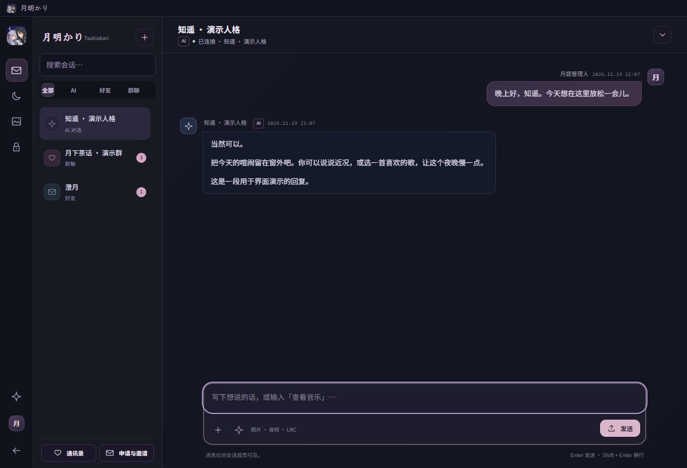

**0.4.2** 放大聊天文字，修复会话分类与通讯录切换时的闪烁。通讯录和关闭提示使用应用内浮窗。见[版本说明](docs/maintenance-0.4.2.md)。

**0.4.4 预发布**统一提供 Android、Windows 安装包和校验文件。安卓打开后直接登录，同一账号的会话、聊天和已读状态由共享后端同步。服务器保留最近30天聊天记录。 [发布说明](docs/release-0.4.4.md) · [安卓指南](docs/android.md)

[下载 Android APK](https://github.com/Shion39-Miku/Shion-Tsukiakari/releases/download/v0.4.4/Tsukiakari-0.4.4-Android.apk) · [Windows 安装版](https://github.com/Shion39-Miku/Shion-Tsukiakari/releases/download/v0.4.4/Tsukiakari-0.4.4-Setup.exe) · [Windows 免安装版](https://github.com/Shion39-Miku/Shion-Tsukiakari/releases/download/v0.4.4/Tsukiakari-0.4.4-Portable.exe) · [SHA-256 校验](https://github.com/Shion39-Miku/Shion-Tsukiakari/releases/download/v0.4.4/SHA256SUMS.txt)

## 功能

- **分得清的会话**：AI、好友、群聊按真实会话类型分类；混合群的 AI 消息带身份标识。
- **好友与邀请群聊**：稳定用户 ID、好友申请、头像和状态；收到定向邀请并接受后加入群聊。
- **服务器 AI**：连接 AstrBot，按群与 AI 成员隔离上下文；个人记忆支持查看、共享授权和撤销。人格由服务器管理，修改后回读确认，冲突或离线保留草稿。
- **两套管理**：网站管理面向「詩音の月光庭院」，沿用草稿保存与确认同步；软件管理面向用户、群聊、好友关系、服务设置及 AI 人格。
- **原生桌面体验**：托盘后台、消息提示音、未读提醒、关闭时询问；保留用户主动播放媒体，软件没有背景音乐。
- **本地持久化**：聊天与网站使用独立数据库；媒体原件入库，音频支持 Range 分段播放。

## 安装与首次启动

0.4.4 的安装包名为 `Tsukiakari-0.4.4-Setup.exe`，免安装版为 `Tsukiakari-0.4.4-Portable.exe`。程序文件为 `Tsukiakari.exe`，界面、快捷方式、托盘和通知显示「月明かり」。Windows 附件为 x64 测试构建，尚无 Authenticode 签名。 [全部发行附件](https://github.com/Shion39-Miku/Shion-Tsukiakari/releases/tag/v0.4.4)

从源码构建时，Windows 构建清单写入 `artifacts/desktop-app.json`。

1. 运行安装版，或把免安装版放到可写文件夹后双击。
2. 空数据目录首次打开时，自行创建本机管理员；没有内置账号或默认密码。
3. 管理员在「软件管理 → 用户管理」创建普通账号，在「服务与 AI 接入」配置服务器连接。
4. 普通账号登录后可使用聊天、个人设置及公开网站栏目；不能管理账号、网站或人格。

旧版升级沿用原账号和完整数据目录。安装器保留升级标识；发现旧 `HoshifuruYoruNi` 或旧便携数据目录时直接复用，避免只迁移数据库而丢失登录态和缓存。详见[数据与升级](docs/architecture.md#数据与升级)。

安卓需要 Android 9 或更新版本及可更新的 Android System WebView。打开后输入共享聊天账号和密码。桌面共享模式使用同一发布配置，桌面本地模式可继续访问原本地资料。 [安卓联调](docs/android.md#开发与测试) · [共享后端和保留策略](docs/chat-retention.md)

## 界面预览

以下均为 **0.4.2 的真实软件窗口**，在隔离的演示环境中截取。AI 聊天截图使用模拟 AstrBot 回复。真实大肥鱼的联调结果见版本说明。

| 好友私聊 | 包含 AI 的群聊 |
| --- | --- |
| 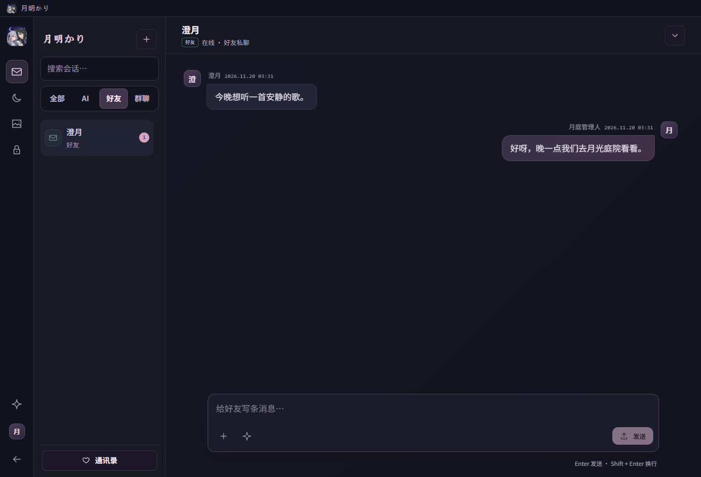 | 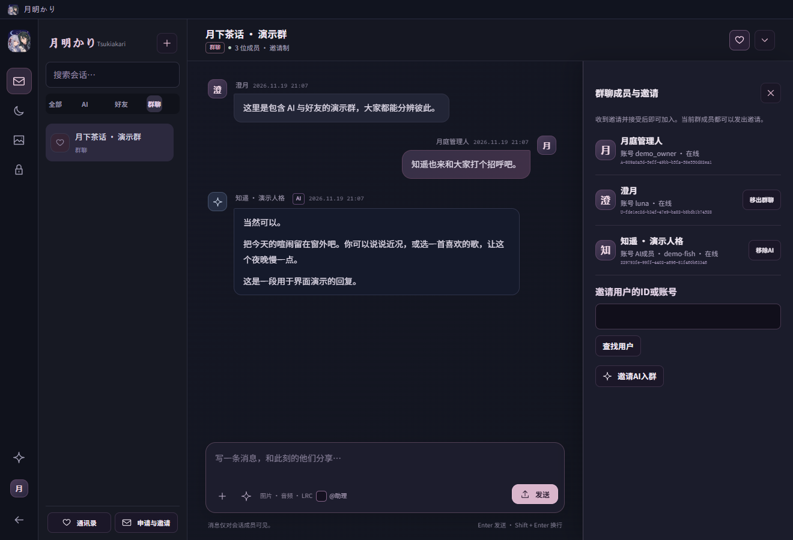 |

| 个人设置 | 网站管理 |
| --- | --- |
| 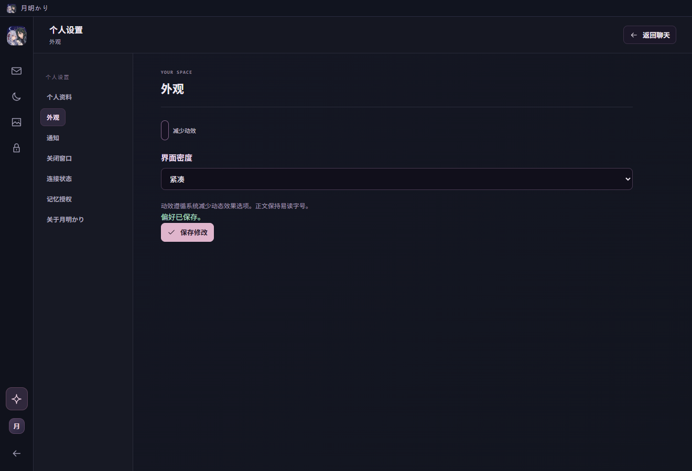 | 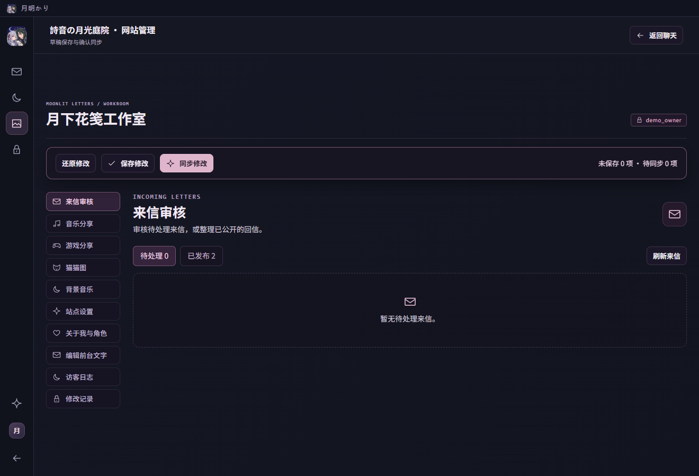 |

| 软件管理 | 服务器人格设置 |
| --- | --- |
| 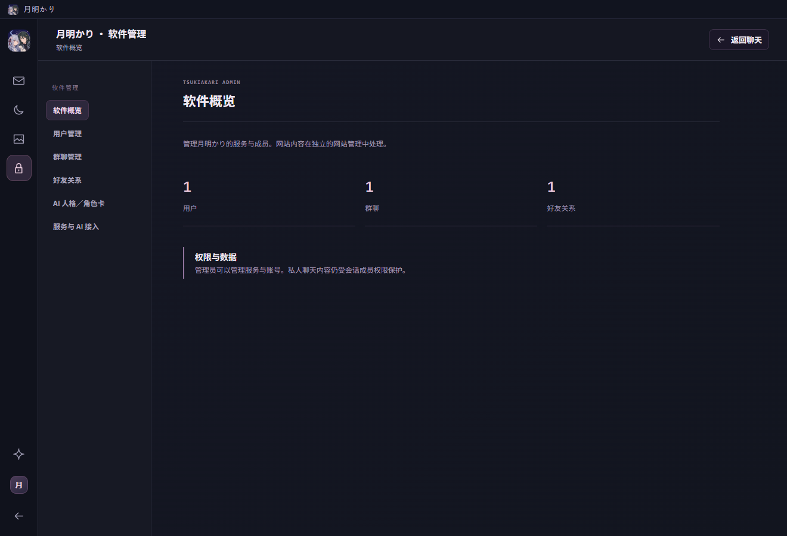 | 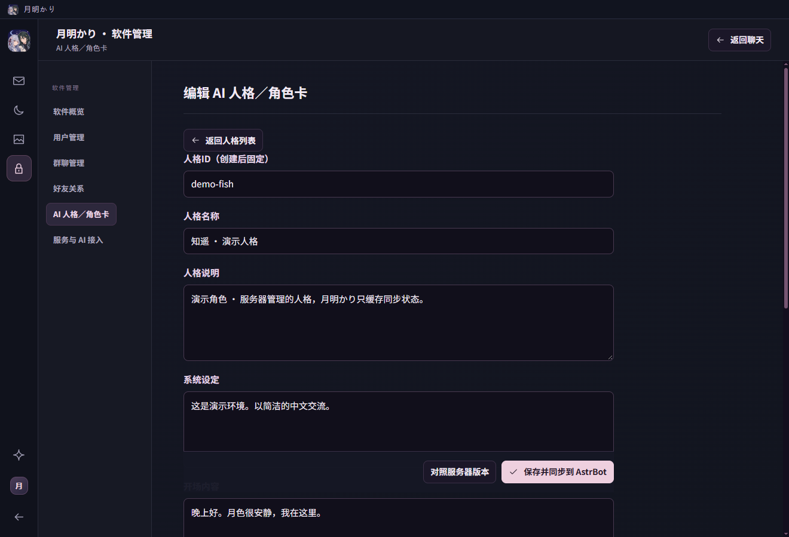 |

[断线时的聊天界面](docs/images/chat-reconnect.png)

| 通讯录 | 关闭提示 |
| --- | --- |
| 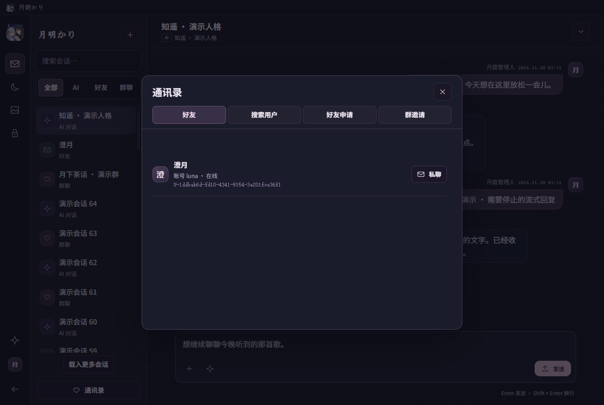 | 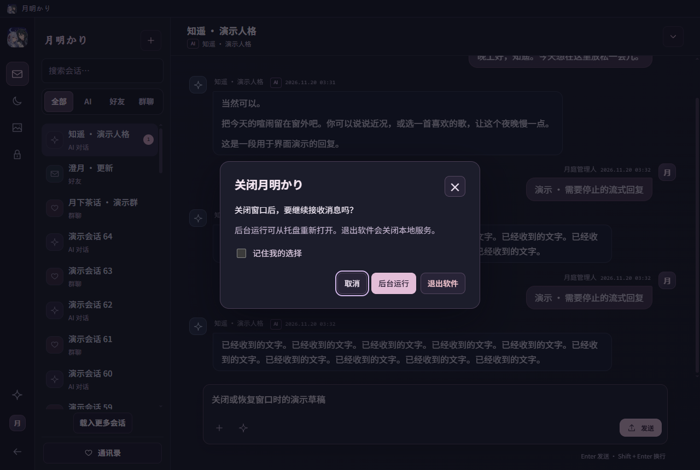 |

### Android 界面

以下界面来自 Android 15 模拟器，使用隔离的演示账号与消息。

| 首次启动 | 连接失败时重试 |
| --- | --- |
| 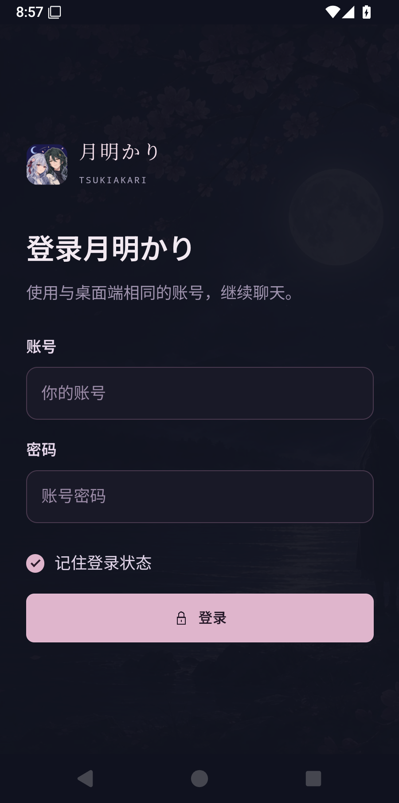 | 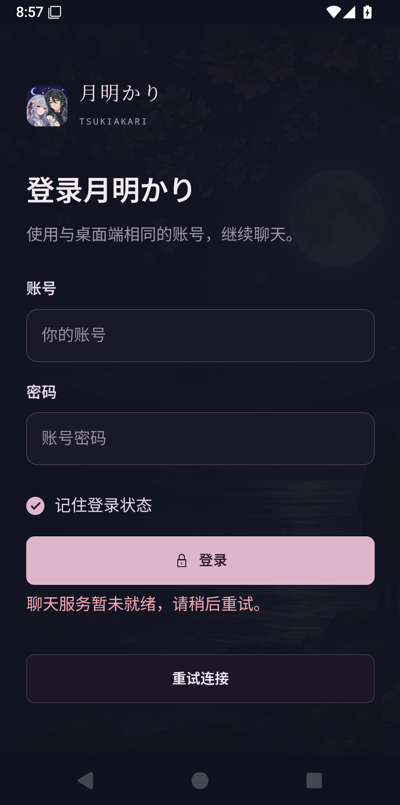 |

| 手机会话列表 | 手机聊天 |
| --- | --- |
| 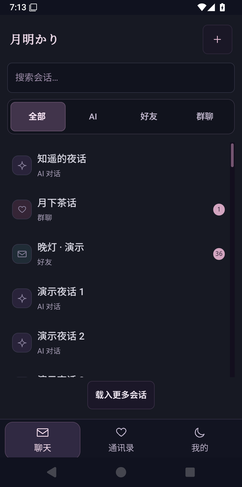 | 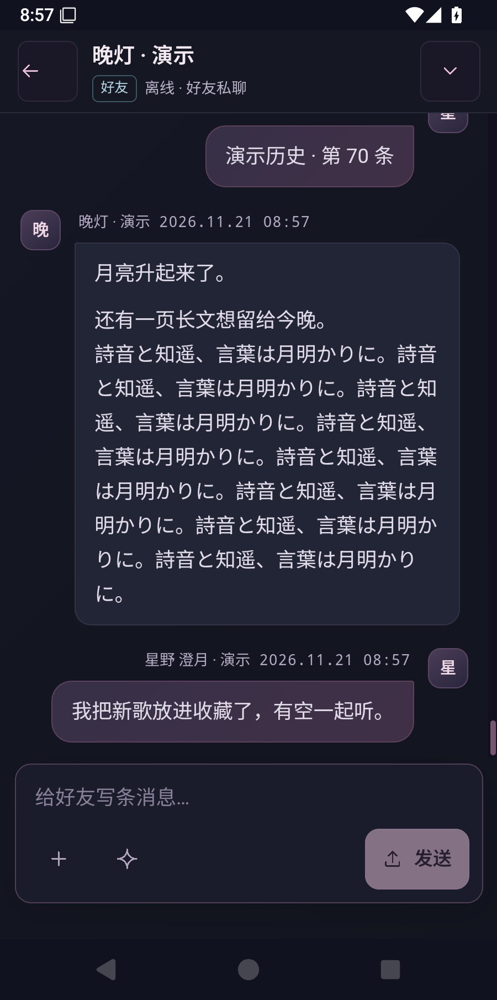 |

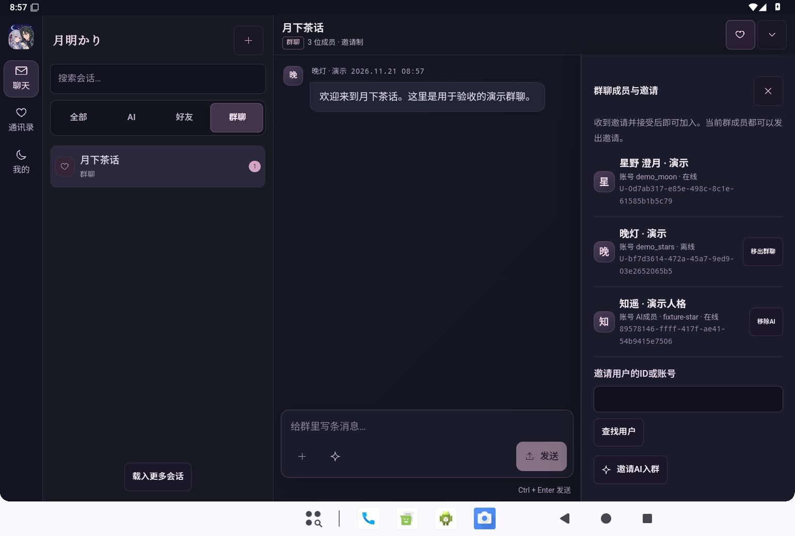

[手机通讯录浮层](docs/images/android-contacts.png)

[AOSP 启动器彩蛋菜单](docs/images/android-shortcut.png) · [暂别月光页面](docs/images/android-farewell.png)

## 使用与权限

- 左侧功能栏进入聊天、月光庭院、个人设置；管理员另有「网站管理」「软件管理」。
- 会话列表的 `+` 明确选择 AI、好友或群聊。分类、搜索、会话位置及输入草稿在切页时保留。
- 连接中断时可留在当前会话编辑，自动重连后补齐消息。翻看旧记录时，点「查看新消息」可回到最新位置。
- 群成员从会话右上角展开，加入需要目标本人接受邀请。退出后服务端撤销群历史和附件读取权限。
- 「个人设置」分别管理资料、外观、通知、关闭行为、连接状态及记忆授权。
- 「软件管理 → AI 人格／角色卡」读取和修改服务器人格，可导入 JSON / PNG；保存按钮显示实际同步结果。
- 通讯录集中展示好友、用户搜索、好友申请与群邀请。Esc 关闭后可继续原会话。可用左右方向键切换已聚焦的分类。
- 首次关闭窗口在应用内询问。后台运行保留连接和托盘，托盘或 `Ctrl+Q` 可明确退出。个人设置可恢复每次询问。`Ctrl+Shift+N` 打开独立登录窗口。

[完整中文教程](docs/guide.md) · [架构、环境变量与迁移](docs/architecture.md) · [验收记录](docs/acceptance.md) · [网站 Bot API](docs/bot-api.md)

## 开发运行

Windows x64，推荐使用项目固定的 Node.js 24.22.3 和 pnpm 11.25.0。固定版本的 Node 许可证随源码提供。依赖已锁定。

```powershell
pnpm install --frozen-lockfile
pnpm --dir desktop install --frozen-lockfile
node desktop/node_modules/electron/install.js
pnpm start:desktop
```

开发启动同样保留现有数据。需要空白环境时先设置 `TSUKIAKARI_DESKTOP_DATA` 为新的目录。演示音乐、歌词和图片由构建脚本初始化，无需下载私人数据库。

```powershell
pnpm test                     # 后端、权限、上传、媒体与持久化
pnpm check:app                # 原生界面与断线回归，生成演示截图
pnpm build                    # 生成不含私有配置的生产源码
pnpm package:desktop          # 安装版与单文件免安装版
pnpm check:desktop            # 把构建复制到工作区外独立验收
pnpm check:desktop:portable   # 验证真实单文件启动器
```

构建直接复制当前 Node 运行时及锁定的生产依赖，不依赖本机旧交付目录。公开包始终使用干净种子库，且不包含 `.env`、管理员、登录会话、聊天记录或服务令牌。未配置 AI 时聊天联系人、群聊、网站栏目和管理仍可使用。

## 提交与发布前安全检查

仓库规则适用于 Windows 和 Linux x64 工具链。已有其他 Git 钩子时先合并。Windows 发布包检查需要可用的 7-Zip 和已安装的桌面构建依赖。 [开发规范](AGENTS.md) · [发布流程](docs/releasing.md)

```powershell
pnpm security:setup         # 以 SHA-256 校验并安装固定版本的 Gitleaks，启用本仓库钩子
pnpm security:check staged  # 检查 Git 暂存内容和作者邮箱
pnpm security:check history # 检查本地可访问引用的历史及 Git 元数据
pnpm security:check release # 打包后检查安装包及免安装包的实际内容
pnpm security:check android release # 检查安卓发布包、签名、源码提交和 HTTPS 地址
```

Git 会在提交及推送时再次检查。检查失败先处理问题再重试。扫描只输出位置和规则，真实 `.env`、数据、备份及日志保留在本机。截图、附件和文本仍需人工核对。CI 在上传前扫描历史、安装包和演示验收报告。

## 后端与 AstrBot

```text
月明かり Windows / Android 客户端
  ├─ 软件后端 → chat.sqlite（用户、关系、群、消息、记忆）
  │    └─ 受限连接器 → AstrBot（权威人格、模型、独立 AI 会话）
  └─ 受控网站接口 → 网站后端 → website.sqlite（内容、媒体、草稿、发布批次）
```

本地默认由内置 Node 子进程运行两个回环 HTTP 服务，通常使用 4180 / 4181；端口冲突自动处理。也可独立部署两个后端。配置示例见 `.env.example`，均使用占位值。桌面保存的 AstrBot 凭据经 Windows 加密，由后端持有，前端不读取已保存令牌。生产配置由各自服务端管理。

本项目不会自动部署云服务、修改 DNS 或发布网站。模型生成的写入建议不能代替管理员的明确保存与同步操作。

## 品牌与素材

显示名：**月明かり**；英文标识：**Tsukiakari**。新版源图在 `public/assets/brand/tsukiakari-source.png`；`pnpm brand:generate` 生成 PNG、ICO 和月亮主题的小尺寸托盘图。角色与网站素材可从对应管理界面替换。

本仓库没有授予素材的额外再分发授权；使用或再次发布角色、图标等素材前，请确认相应权利。
